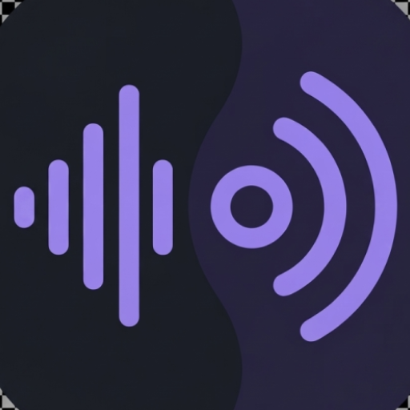
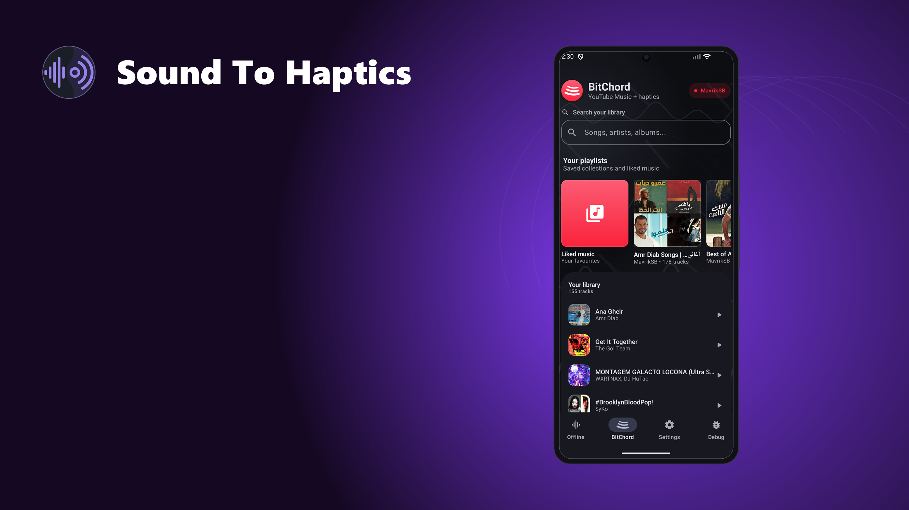

<p align="center">
  
</p>

<h1 align="center">Sound To Haptics</h1>

<p align="center"><strong>Turn any audio into a physical listening layer</strong></p>

<p align="center">
  
  &nbsp;
  
  &nbsp;
  
  &nbsp;
  
</p>

<p align="center">
  <a href="#download">Download</a> ·
  <a href="#features">Features</a> ·
  <a href="#setup">Build</a> ·
  <a href="#variants">Variants</a> ·
  <a href="#license">License</a>
</p>

<br>

<p align="center">
  
</p>

---

Sound To Haptics takes music you already have and turns it into something your hands can feel. Import an audio file — or connect a YouTube Music account — and the app builds a haptic profile of the whole track: bass weight, transient impacts, musical flow. Built for Pixel-class LRA hardware on real Android devices.

## Download

The latest signed APK lives on GitHub Releases:

**[Sound-To-Haptics releases → `Stable-V3`](https://github.com/RNDMBG/Sound-To-Haptics/releases/tag/Stable-V3)**

Direct link: `app-withBitChord-release.apk` (arm64-v8a). Android 8.0+ required; Android 10+ recommended; best results on phones with a capable vibrator.

## Features

- **Offline conversion** through the existing FFmpeg audio-to-OGG pipeline — the haptic track is synthesized on-device, next to the music.
- **Persistent haptic library** in `filesDir/haptic_library` (never `cacheDir`). Converted files keep the original song name as their `.ogg` basis, retain metadata, and survive restarts with delete/resume/seek/duplicate handling.
- **BitChord integration** — YouTube Music with Google sign-in in-app: search, your library, playlists, liked songs, radio, and local haptic capture. Stream resolution and the entire InnerTube API layer are built on [BitChord](https://github.com/kushagrasinghx/BitChord), used under GPL-3.0.
- **Tap to play with haptics from second zero** — first tap on a track downloads it, analyzes it once, caches the haptic profile, then plays it with haptics already in sync. Second and later taps stream instantly with the cached profile.
- **Transient engine** — an antiviral-spam DSP pipeline (accent budget, spacing, beat tracking, scene gating for silence/quiet/build-up/drop) so the haptics thud with the music instead of drumming over it.
- **Material You design** — a Pixel-esque three-tab layout (Offline → BitChord → Settings) with spring press feedback, dynamic backgrounds, reduce-motion support, and true dark mode.
- **Six-step first-launch guide**, replayable from Settings → Help.
- **Versioned musical-layer analysis** shared by Offline and BitChord: bass weight, vocal/melodic flow, percussion/transients, coalesced events, persisted timelines. Full neural stem separation is intentionally not embedded.
- **Cancellable, generation-safe offline conversion** — replacing or cancelling a job stops FFmpeg, removes scratch files, and prevents stale callbacks from creating library entries.
- **Debug tooling** — supported-device checks, DSP diagnostics, motion inspector — available only in debug builds.

## Setup

1. Open the project in Android Studio and select this folder as the project root.
2. Sync Gradle and connect a physical Android device. Haptics require a device with a capable vibrator; the emulator is not a useful test target.
3. Choose a build variant below and run it.

<a name="variants"></a>
## Build variants

The product flavor keeps BitChord's optional GPL-3.0 dependency tree out of the offline-only build:

- `offlineOnlyDebug` — offline conversion and persistent library; no BitChord code or dependencies.
- `withBitChordDebug` — adds BitChord's YouTube Music sign-in, search, playback, and synchronized haptics. **This variant is a GPL-3.0 work based on [BitChord](https://github.com/kushagrasinghx/BitChord); see LICENSE and THIRD_PARTY_LICENSES.txt before distributing it.**

```bash
./gradlew assembleOfflineOnlyDebug
./gradlew assembleWithBitChordDebug
```

Release builds are signed with the release keystore configured in `local.properties` (not committed):

```properties
release.storeFile=release.keystore
release.storePassword=••••••••
release.keyAlias=key0
release.keyPassword=••••••••
```

The build provisions a JBR 21 daemon toolchain automatically. Use a physical Android 8.0+ device; Android 10+ is required for full haptic-playback fidelity and Android 11+ with supported primitives for the optional transient thud/click engine.

## License & attribution

This project is licensed under GPL-3.0. The `withBitChord` flavor is a derived work of [BitChord](https://github.com/kushagrasinghx/BitChord), also GPL-3.0; all upstream notices are retained in `THIRD_PARTY_LICENSES.txt`.

Notable open-source components include BitChord's InnerTube layer ([innertubex](https://github.com/MetrolistGroup/innertubex), GPL-3.0), NewPipe extractor (GPL-3.0-or-later), and [Jetpack Compose](https://developer.android.com/jetpack/compose) (Apache-2.0).

This app is not affiliated with, endorsed by, or connected to the BitChord project, Google, or YouTube in any way. YouTube and YouTube Music are trademarks of Google LLC. BitChord is a trademark of its respective owner, used here only as a faithful description of the bundled integration.
